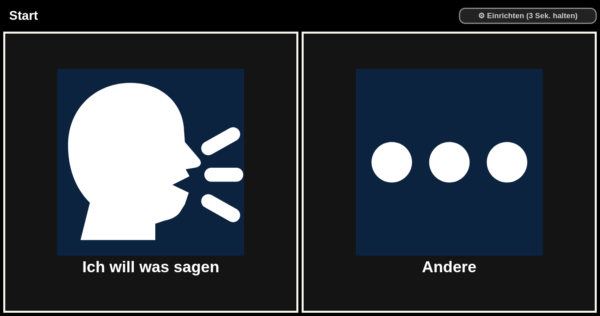
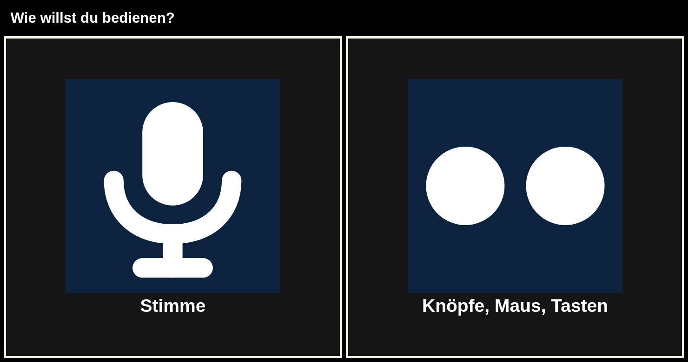
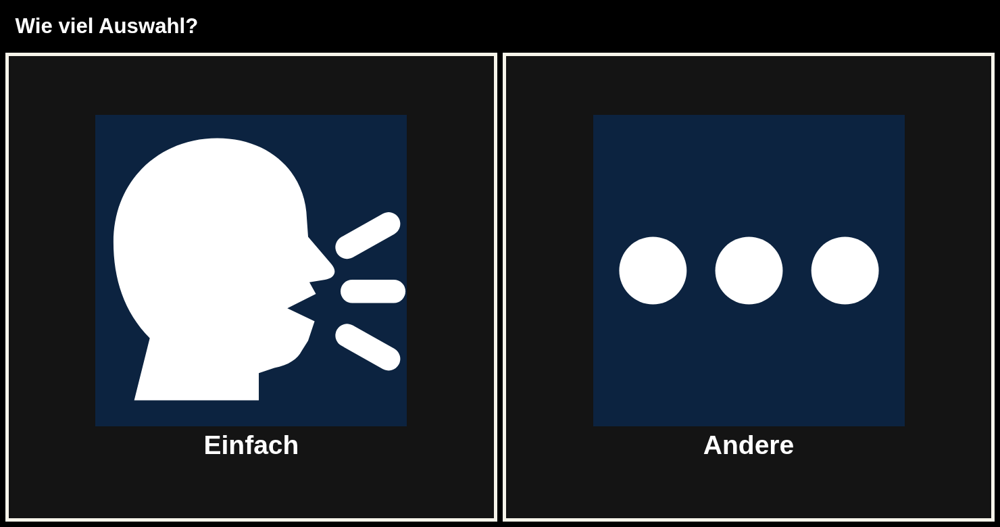
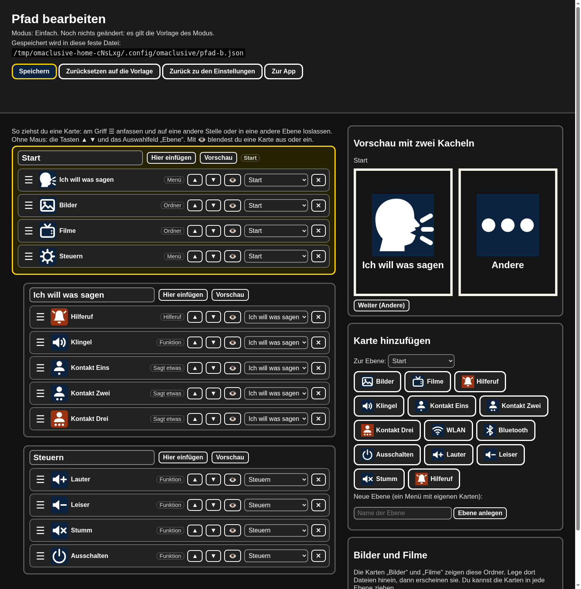
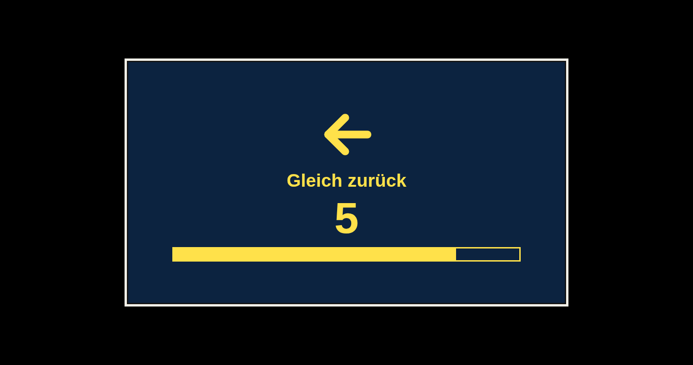

# Omaclusive

**Deutsch** · [English](README.md)

Offene Bild-Fernbedienung für Omarchy. Große Bildkarten, ein oder zwei Knöpfe, alles offline auf diesem Rechner.
Keine Telemetrie, keine Diagnose und keine Therapie. Der Hilferuf ist kein Notruf-Ersatz.



## Kein Notruf (112)

**Omaclusive ist kein Notfallsystem.** Der Hilferuf schickt nur eine Nachricht an ein Handy, das du selbst einrichtest.
Niemand überwacht ihn, nichts geht an den Rettungsdienst, und die Nachricht kann ausfallen (kein Netz, Handy aus, App zu).
Im Notfall **112** anrufen oder anrufen lassen. Verlass dich dafür nicht auf Omaclusive.

## Haftungsausschluss

- Omaclusive ist **kein Medizinprodukt**. Es stellt keine Diagnose, ist keine Therapie und verspricht kein Ergebnis.
- Die Nutzung geschieht **auf eigene Verantwortung**. Angehörige und Betreuende entscheiden, ob es zur Person passt.
- Die Software steht unter der GPL-3.0, **ohne jede Gewähr** (siehe `LICENSE`, Abschnitte 15 und 16).
  Die Autoren haften nicht für Schäden, die aus der Nutzung entstehen.

## Datenschutz

- **Keine Telemetrie.** Omaclusive verfolgt dich nicht, hat keine Konten und sendet keine Nutzungsdaten.
- Alles läuft offline auf diesem Rechner: Bilder, Filme, Stimme, Spracherkennung.
  Die einzige Ausnahme ist der **Hilferuf**. Er schickt eine kurze Nachricht an einen ntfy-Server.
  Standard ist `https://ntfy.sh`, ein öffentlicher Dienst eines Dritten. In der Betreuung kannst du einen eigenen ntfy-Server eintragen.
- Gesendet wird der feste Text „Jemand möchte etwas sagen.“ an ein langes Zufalls-Thema (Topic). **Ein Name wird nicht gesendet.**
  Der Name wird nur auf diesem Rechner gesprochen. Der Server sieht das Topic, die Zeit und die IP-Adresse dieses Rechners, wie bei jeder Web-Anfrage.
- **Halte das Topic geheim.** Wer es kennt, kann die Nachrichten lesen und selbst welche dorthin schicken.
  Gib den Link nur an die Handys, die den Ruf bekommen sollen, und stell ihn nicht ins Netz. In der Betreuung gibt es neue Zufalls-Topics.
- **Fernsehen** (und Radio als Stream) holt das Programm erst, wenn jemand einen Sender wählt, direkt beim eingetragenen Sender. Der Sender sieht dabei die IP-Adresse dieses Rechners. Omaclusive schickt keine eigenen Daten mit.
- Ohne Netz wird nichts gesendet. Der Rest funktioniert weiter.

## Auf diesem Rechner

Der Server hört nur auf `127.0.0.1`. Jeder Start erzeugt ein neues Sitzungsgeheimnis und speichert es so, dass nur dieser Benutzer es lesen kann (Datei `0600` in einem Ordner `0700`: unter `$XDG_RUNTIME_DIR/omaclusive/`, wenn dieses Verzeichnis privat ist und nicht in dem Ordner liegt, den der Server ausliefert, sonst unter `~/.local/state/omaclusive/run/`). Es liegt nie unter der Web-Wurzel, auch nicht unter `~/.local/share/omaclusive/`. Der Starter gibt es an den Browser dieses Benutzers. Es gibt keine Anmeldung und keinen zusätzlichen Schritt für die Person, die die zwei Knöpfe drückt.

Andere Konten auf demselben Rechner können nicht ausschalten, neu starten, Links öffnen, die Konfiguration ändern oder eine Kachel-Aktion ausführen. Die Prüfung von Host und Origin gilt für jeden geschützten Weg, auch für Kachel-Aktionen. Öffnen, Zurück, die Dateiauswahl und der Hinweiston gehen über POST. Ein Feld `confirm: true` in der Anfrage schaltet den Rechner nicht aus: Ausschalten, Neustart und Sperren laufen erst, wenn der Server für diese Frage eine einmalige Bestätigung ausgestellt hat und die Ja-Kachel sie zurückschickt.

## Installation

```bash
git clone https://github.com/smeekraft/omaclusive.git
cd omaclusive
./install.sh
```

Danach im App-Menü nach **Omaclusive** suchen. Es startet nicht von selbst. Beim ersten Start kommen ein paar große Fragen.

`install.sh` läuft ohne Root, legt eine eigene Kopie unter `~/.local/share/omaclusive` an und lädt Piper inkl. Stimme mit Prüfsumme.
Sprache: ohne Angabe nach der Systemsprache (`$LANG`: Deutsch oder Englisch, sonst Englisch). Erzwingen mit `./install.sh --lang de` oder `--lang en`.
Später in der App ändern: die kleine Taste **⚙ Einrichten** 3 Sekunden halten, dann **🌐 Sprache**. Die Stimme wird beim ersten Mal geladen (etwa 65 MB, mit Prüfsumme).
Voraussetzungen: Omarchy oder Arch-ähnlich, `chromium`, `python3`, `curl`, optional `mpv` für Filme und Fernsehen, `yt-dlp` für YouTube-Live-Sender.

## Als Omarchy-Plugin

Omaclusive kann als ein ruhiges Symbol in der Omarchy-Leiste (Quattro) wohnen.

```bash
omarchy plugin add https://github.com/smeekraft/omaclusive.git --enable
```

`omarchy plugin add` selbst führt nichts aus. Beim ersten Klick auf das Symbol öffnet sich ein Terminal und das eigene `install.sh` läuft sichtbar durch (ohne Root-Rechte). Danach startet ein Klick Omaclusive im Vollbild.

Benötigt: `python3`, `chromium`, `curl`. Optional: `mpv`, `yt-dlp`, `espeak-ng`.
Externe Downloads von `install.sh`: Piper (GitHub-Release) und eine Piper-Stimme, beide sha256-geprüft.
Eine vorhandene `config.json` bleibt unangetastet.

Aktualisieren: `omarchy plugin update smeekraft.omaclusive`, danach in `~/.config/omarchy/plugins/smeekraft.omaclusive` noch einmal `./install.sh`.

Entfernen:

```bash
omarchy plugin remove smeekraft.omaclusive
rm -rf ~/.local/share/omaclusive ~/.local/share/applications/omaclusive*.desktop
```

## Für Angehörige und Betreuende

Die Kurzfassung für die Person, die Omaclusive einrichtet.

- **Dateien.** Bilder kommen nach `Bilder/Omaclusive`, Filme nach `Videos/Omaclusive`, beides im Heimatordner.
  Sie erscheinen als Karten. Ein leerer Ordner zeigt eine Karte, die sagt, dass hier noch nichts ist.
- **Betreuer-Bereich.** Oben rechts steht die kleine Taste **⚙ Einrichten**. **3 Sekunden halten** (Maus oder beide Pfeiltasten gleichzeitig), der gelbe Balken läuft voll.
  Hier gibt es die Kontakte, das Bild-Blatt zum Laminieren, den Hilferuf, den Bildsatz und die Geschwindigkeit. **Strg+Umschalt+E** geht auch.
- **Die Knöpfe.** Omaclusive zeigt immer nur zwei große Kacheln. Jeder Taster, der eine Taste sendet, passt, und eine Maus auch.
  - Zwei Knöpfe (Standard): **Pfeil links** wählt die linke Kachel, **Pfeil rechts** die rechte. Mit der Maus: **Linksklick** ist Knopf 1 (links),
    **Rechtsklick** ist Knopf 2 (rechts). Eine Kachel direkt anklicken geht auch. Eine günstige Maus mit zwei Tasten ersetzt also zwei Knöpfe.
  - Ein Knopf: die Markierung wandert allein von Kachel zu Kachel. **Leertaste, Enter oder Pfeil hoch** (mit der Maus: jeder Klick) wählt die markierte Kachel.
  - Zu schnelle Drücke (unter 300 ms) zählen nicht und lassen die Kachel kurz gelb aufleuchten.
- **Mikrofon.** Das Mikrofon-Ohr (Sprachsteuerung) ist aus. `"hoeren": true` in `config.json` schaltet es ein. Bei Bluetooth-Kopfhörern kann es den Ton verschlechtern.
- **Tempo (ein Knopf).** `knopf.scanMs` ist die Zeit pro Karte in Millisekunden. Erlaubt: `400` bis `10000`, die Beispiel-Config nimmt `3000`.
  **Verpasst die Person die Karte oft, mach es langsamer** (zum Beispiel `4000` oder `5000`). In der Betreuung gibt es einen Knopf für langsam (3 s), normal (2 s) und schnell (1 s).
- **Zurück zum Start.** Ohne Eingabe geht Omaclusive nach `zurueck.sekunden` Sekunden zum Start (Standard `20`, `0` ist aus, höchstens `60`).
  Fünf Sekunden vorher kommt eine Warnung mit großem Bild und Ansage. Braucht die Person mehr Zeit, erhöhe den Wert. Die Betreuung bietet 20, 30, 40 Sekunden oder aus.
- **Stimm-Tempo.** `stimmeTempo` in `config.json` (Standard `1.15`, ruhiger als das Piper-Original). Höher ist langsamer, zum Beispiel `1.3`. Erlaubt `0.5` bis `2.0`.
  Die fertigen Aufnahmen in `audio/` sind mit `1.15` erzeugt (`python3 audio_erzeugen.py`); bei einem anderen Wert spricht Piper die Sätze live.
  Die Ansage nennt nur die zwei Bildwörter. Eine neue Ansage stoppt die alte. Fehler beim Abspielen stehen in `~/.local/share/omaclusive/log.txt`.
- **Probiere es mit der Person aus,** bevor du dich darauf verlässt, und bleib am Anfang in der Nähe.

## Sprache: Deutsch und Englisch

Omaclusive gibt es auf Deutsch (Standard) und auf Englisch. Das gilt für Bildschirmtexte,
Ansagen, die Einrichtung, die Beispiel-Karten und die Stimme.

- In `config.json` steht `"language": "de"` oder `"language": "en"`. Fehlt der Eintrag, gilt Deutsch.
  Eine andere Sprache fällt auf Englisch zurück. Fehlt ein einzelner Text, bleibt das deutsche Original stehen.
- In der App: **Einrichten, Sprache und Stimme**. Große Kacheln: Deutsch, English (US, männlich, Standard), English (US, weiblich), English (US, weiblich, beste Qualität), English (UK, weiblich). Beim allerersten Start ist die Sprache die erste Frage (Deutsch | English, die Systemsprache ist vorgewählt). Die Stimme wird beim ersten Mal geladen. Neue Sprachen: `locales/xx.json` und ein Eintrag in `voices.json` (Name, Modell, SHA256).
- Neue Kopie auf Englisch: `./install.sh --lang en`. Das lädt die englische Stimme (John, männlich, gemeinfrei) und nimmt `config.example.en.json`.
- Bestehende Kopie umstellen: `python3 sprache_wechseln.py en` (zurück: `de`). Das übersetzt nur die mitgelieferten Texte
  in `config.json`, eigene Namen und Sätze bleiben. Eine Sicherung `config.json.bak` entsteht. Danach den Server neu starten.
- Texte stehen in `locales/de.json` und `locales/en.json`. Der Schlüssel ist der deutsche Originaltext.
  Neue Sprache: `locales/<code>.json` anlegen und in `i18n.py` und `sprache.js` eintragen.
- Plugins: `plugin.json` ist Deutsch, `plugin.en.json` daneben ist Englisch. Fehlt die Datei, wird `plugin.json` genommen.
- Aufnahmen: `audio/de/` und `audio/en/` enthalten die festen Ansagen als fertige Dateien, damit sie ohne Piper sofort klingen.
  Neu erzeugen mit `python3 audio_erzeugen.py`. Sätze mit Namen werden live gesprochen.
- Sprecherkennung („Sag eines“): Deutsch mit `ohr/model`, Englisch mit `ohr/model-en` (Vosk small-en-us). Fehlt das englische Modell, bleibt die Sprecherkennung aus, Tasten und Bilder gehen weiter.

## Kartenbilder: glatt oder Pixel

Zwei vollständige Bildsätze liegen bei. Gleiche Dateinamen, gleiche Farben (Ja gelb, Nein und Zurück blau mit gelbem Zeichen, Hilferuf und Schmerz rot, Kontrast mindestens 7:1).

- **glatt** (Standard): klare Linien, gut zu erkennen. `img/glatt/` und `plugins/<name>/glatt/`.
- **pixel**: der Pixel-Look im Omarchy-Stil. `img/pixel/` und `plugins/<name>/pixel/`.

Gewählt wird in `config.json` mit `"bildstil": "glatt"` oder `"bildstil": "pixel"`. Fehlt der Eintrag, gilt glatt. Auf der Einrichtungsseite schaltet der Knopf „Bilder“ um und speichert.
Alte Configs mit `img/xyz.svg` laufen weiter: der Server liefert das Bild aus dem gewählten Satz. Mit `img/glatt/xyz.svg` oder `img/pixel/xyz.svg` legst du dich auf einen Satz fest. Ein Plugin darf seine Bilder auch direkt im Ordner haben, sie gelten, wenn es keinen Unterordner `glatt/` oder `pixel/` gibt. Neustart nicht nötig, Seite neu laden.
Das Bild-Blatt (Betreuung) nutzt immer den Pixelsatz.
Neu bauen: `python3 tools/karten_glatt.py img/glatt plugins/grundbeduerfnisse/glatt` und `python3 tools/karten_pixel.py img/pixel plugins/grundbeduerfnisse/pixel`.

## Alltag

Im Standard-Modus (b) gibt es sieben Bereiche am Start: **Ich will was sagen**, **Bilder**, **Filme**, **Fernsehen** (nur mit eingetragenen Sendern), **Radio**, **Aufgaben**, **Steuern** (Lautstärke, WLAN, Bluetooth, Ausschalten).
Bluetooth braucht `bluetoothctl` (BlueZ). Regel überall: **höchstens zwei große Kacheln**, Zurück und Start sind immer erreichbar, ruhig und vorhersagbar.
Alles weitere ist ein Zusatz. Ein Ordner unter `plugins/<name>/` mit `plugin.json` und Bildern
wird zur Karte, sobald er da ist. Weg damit, und die Karte ist weg.
Im Baum liegt ein Beispiel, Grundbedürfnisse: Durst, Hunger, Toilette, Schmerz, Pause, Kalt, Warm.
Jede Karte sagt einen Satz. Leere Karten bleiben unsichtbar.

Bilder liegen in `Bilder/Omaclusive`, Filme in `Videos/Omaclusive`, jeweils im Heimatordner.
Angehörige legen die Dateien dort ab. Ein leerer Ordner zeigt eine Karte und sagt: „Hier ist noch nichts.“
Es gibt dabei keinen fremden Dateidialog.

**Bilder.** Nach der Ordnerwahl startet die Diaschau von selbst (einfacher Modus). Jedes Bild bleibt `bildSekunden` Sekunden (Standard `10`, erlaubt 3 bis 120). Zwei Kacheln: **Zurück** (zum Start) und **Pause**. In der Pause heißen die Kacheln **Weiter** und **Zurück**.

**Filme.** Die Liste zeigt **zwei Filme gleichzeitig**, wie bisher (das Abtasten läuft wie bisher). Als dritte, kleine Möglichkeit gibt es **Weiter blättern** in einer schmalen Zeile darunter (mit einem kleinen **Zurück**). Erreichbar per Abtasten, Mausklick oder Pfeil nach unten. Nach der letzten Seite geht es wieder von vorn los. Ein Film läuft im Fenster mit zwei Kacheln, **Zurück** und **Pause** (in der Pause: **Weiter** und **Zurück**). Kann der Browser ein Format nicht abspielen (zum Beispiel manche `.mkv`), öffnet sich der Film stattdessen mit `mpv`. Dann gibt es keine Pause-Kachel (mpv hat eigene Tasten). Fehlt mpv, sagt die Karte „Das geht hier nicht.“ und geht nach Hause.

## Radio

Radio ist eine Hauptkachel. Die Quelle steht in der `config.json` unter `radio`:

```json
"radio": { "modus": "browser", "name": "Radio", "url": "https://openradioworld.com/", "stream": "" }
```

- `modus: "browser"` öffnet `url` in einem eigenen Vollbild-Browserfenster (Rückfall, geht immer mit Internet).
- `modus: "stream"` spielt `stream` (ein `http(s)`-Audiostream) **in** Omaclusive mit den Kacheln Zurück und Pause.
- Keine Adresse eingetragen: Die Karte sagt ehrlich „Das ist noch nicht eingerichtet.“ Es öffnet sich nichts.

Was bei **Open Radio Atlas** stimmt: Es ist ein natives Omarchy-Plugin (Quickshell, Globus mit mpv), keine Webseite. Es lässt sich nicht in das Omaclusive-Fenster einbetten und hat keinen dokumentierten Startbefehl, deshalb startet Omaclusive es nicht. Standard ist darum die Browserseite *Open Radio World*. Ein Lieblingssender als Stream-Adresse ist die ruhige, verlässliche Wahl. Beides wird im Betreuer-Bereich (`setup.html`) eingestellt. Radio braucht Internet (oder einen Sender im Heimnetz).

## Fernsehen

**Fernsehen** ist eine Hauptkachel (Modus b und c). Dahinter liegt eine Kachel je Lieblingssender, meist zwei oder drei. Wie überall sind höchstens zwei Kacheln zu sehen, bei mehr Sendern blättert **Andere** weiter.

- Ein Druck auf einen Sender startet ihn **sofort im Vollbild** (mit `mpv`). Kein Startbild, keine Bedienleiste, keine Texte, kein Menü.
- Im Vollbild, zwei Knöpfe: **links = Zurück zum Start**, **rechts = Pause / Weiter**, **beide 3 Sekunden halten = Zurück** (die Zeit ist `setupHoldMs`). **Esc** geht auch. Mit der Maus: Linksklick = links, Rechtsklick = rechts.
  Ein Knopf (`knopf.modus` `"ein"`): kurz drücken = Pause / Weiter, 3 Sekunden halten = Zurück. Die Sperrzeit `debounceMs` gilt wie sonst auch.
- **Geht ein Sender nicht** (kein Netz, Adresse falsch, kein Bild nach `fernsehen.wartenSekunden`, Standard `30`): ein ruhiges Bild mit „Geht gerade nicht“, eine kurze Ansage, dann der Start. Ein Druck schließt die Meldung, sonst geht sie nach 8 Sekunden von selbst weg. Kein Fachtext.
- Ohne eingetragenen Sender ist die Kachel unsichtbar. Dann ist alles wie vorher.
- Eine Erinnerung beendet das Fernsehen, damit sie zu sehen ist.

Die Sender stehen in `config.json` (im Betreuerbereich unter **Sender speichern** für bis zu drei Sender):

```json
"fernsehen": {
  "sender": [
    { "name": "Das Erste", "bild": "img/fernsehen.svg", "stream": "https://daserste-live.ard-mcdn.de/daserste/live/hls/de/master.m3u8" },
    { "name": "hr", "bild": "img/fernsehen.svg", "stream": "https://hrhls.akamaized.net/hls/live/2024525/hrhls/master.m3u8" }
  ],
  "wartenSekunden": 30
}
```

- `stream`: eine `http(s)`-Adresse, die `mpv` spielen kann (HLS `.m3u8` der Sender) oder ein **YouTube-Live-Link** (dafür braucht `mpv` das Programm `yt-dlp`). Höchstens 6 Sender.
- `bild`: ein Bild aus `img/` (Standard `img/fernsehen.svg`).
- Die Oberfläche schickt nur die Nummer des Senders. Die Adresse liest der Server immer aus `config.json`.
- Fernsehen braucht Internet. Manche Sender zeigen ihr Programm nur in Deutschland oder blenden einzelne Sendungen aus Rechtegründen aus. Die Adressen ändern sich manchmal; dann den neuen Link eintragen.
- Kein Konto, keine Telemetrie. Omaclusive selbst ruft nur die eingetragene Adresse auf (über `mpv`).

**Ruhig und sicher bei Fotosensibilität (Epilepsie).** Im Fernsehen-Teil blinkt, wackelt und flackert nichts, es gibt keine Startanimation (Regel nach WCAG 2.3.1: nie mehr als drei Blitze pro Sekunde, hier gar keine). `mpv` startet mit `--osc=no --osd-level=0 --no-osd-bar`, ohne Untertitel und ohne eigene Konfiguration, schwarz, bis das Bild da ist. Die Meldung „Geht gerade nicht“ ist ein stilles Bild. Auf den Inhalt der Sender selbst hat Omaclusive keinen Einfluss.

## Erinnerungen und Aufgaben

Beides pflegen Betreuende im Betreuer-Bereich auf der Seite **Erinnerungen und Aufgaben** (`pflege.html`). Die Daten liegen in `~/.config/omaclusive/pflege.json`.

- **Erinnerung:** Uhrzeit, kurzer Text, Wiederholung (einmal, täglich, werktags, Wochenende, gewählte Tage). Ist sie fällig, steht der Text groß da und wird **vorgelesen** (etwa jede Minute wieder, bis zu zehnmal). Eine einzige Kachel, **Okay**, bestätigt (jede Taste geht). Eine bestätigte Erinnerung kommt an diesem Tag nicht wieder. Ein laufender Film oder das Radio wird solange angehalten. Geprüft wird alle `erinnerungPruefSekunden` (Standard 20), Wiederholung nach `erinnerungWiederholSekunden` (Standard 60).
- **Aufgabenliste:** Die Starkachel **Aufgaben** zeigt immer eine offene Aufgabe. Die Kachel hakt sie ab, dann kommt die nächste. Am Ende sagt sie „Nichts zu tun.“
- Grenzen: 30 Erinnerungen, 50 Aufgaben, je 120 Zeichen. Die Schnittstelle ist nur lokal.
- Grundbedürfnisse (Durst, Hunger, Schmerz ...) bleiben unter „Ich will was sagen“. Der Hilferuf ist unverändert.

## Streamingdienste (Platzhalter)

Netflix, Joyn und andere sind in dieser Version **nicht** enthalten. In der `config.json` steht nur `"streaming": {"aktiv": false, "dienste": []}` als Platzhalter. Es tut nichts.

## Omarchy ohne Maus

Alles geht mit den Pfeiltasten oder der linken und rechten Maustaste (auch mit einem Knopf und Abtasten). Pfeil nach unten heißt in Listen „Weiter blättern“.

Startweg: `start-talker.sh` startet den Server auf `127.0.0.1:8795` und öffnet dann Chrome/Chromium mit `--kiosk --start-fullscreen --class=omaclusive` und eigenem Profil. Der Browser bekommt das Sitzungsgeheimnis aus einer privaten Startdatei (siehe „Auf diesem Rechner“). `startlib.sh` prüft 20 Sekunden lang, ob das Fenster wirklich den Fokus hat (`hyprctl activewindow`), und ruft sonst `hyprctl dispatch focuswindow class:omaclusive` auf, damit die Tasten ankommen. Autostart: im Betreuer-Bereich **Mit dem Rechner starten** anhaken (siehe oben). Der Mauszeiger wird nicht gebraucht. Die Seite nimmt sich beim Öffnen auch selbst den Fokus.
Optionale Hyprland-Taste, um es zurückzuholen: `bind = SUPER, O, exec, hyprctl dispatch focuswindow class:omaclusive` in `~/.config/hypr/bindings.conf`.

Kontakte unter „Ich will was sagen“ sind Platzhalter: Kontakt Eins, Zwei und Drei.
Der Name wird gesprochen. Echte Personen stehen hier nicht drin.

In der Betreuung gibt es ein **Bild-Blatt**. Dieselben Bilder wie auf dem Schirm, zum Laminieren.
Der Hilferuf bleibt die erste Karte unter „Ich will was sagen“, danach die Klingel, danach die Kontakte.

Der Autostart (eine Startdatei der Sitzung, keine automatische Anmeldung) wird nie still gesetzt. Im Betreuer-Bereich ist er ein Häkchen **Mit dem Rechner starten**: Häkchen an legt `~/.config/autostart/omaclusive.desktop` an (sie startet `start-talker.sh` dieses Ordners), Häkchen aus entfernt genau diese Datei. Das Häkchen zeigt den echten Zustand (es liest, ob die Datei existiert), und `autostart` in der `config.json` folgt ihm. Die Einrichtung legt ihn nur nach einem ausdrücklichen **Ja** an.

**Kachel wählen.** Die gewählte Kachel wächst sanft auf das 1,15-Fache, bekommt einen dickeren Rahmen und bleibt `waehlSekunden` Sekunden so stehen (Standard `3`, `0` = sofort, höchstens `10`), bevor die Eingabe läuft. Die andere Taste bricht in dieser Zeit ab. So ist das Ergebnis vorhersehbar.
Das ist eine Startdatei der Sitzung, kein Einschalten des Rechners von allein und kein automatisches Anmelden.

SMS ist nicht im Kern. Das wäre später ein eigenes Zusatzmodul.

## Erstes Öffnen

Ist `einrichtung.fertig` in `config.json` nicht `true` (frische Config) oder stammt die Einrichtung aus einer älteren Version (kein `einrichtung.stand`), startet Omaclusive als Allererstes mit der Einrichtung.
Sie wartet ohne Zeitlimit und überspringt nie von allein: Es gilt nichts, bis jemand eine Kachel drückt.
Jede Frage zeigt höchstens zwei große Kacheln und wird vorgelesen:

1. **Wie willst du bedienen?** **Stimme** oder **Knöpfe, Maus, Tasten**. Stimme schaltet das Mikrofon-Ohr ein (`"hoeren": true`, braucht Vosk, optional).
2. **Wie viele Knöpfe?** (nur bei Knöpfen) **Zwei Knöpfe** oder **Ein Knopf**.
3. **Wie viel Auswahl?** **Einfach** (Modus b, Standard) und über **Andere** **Ganz einfach** (Modus a) oder **Mehr Auswahl** (Modus c).
4. **Mit dem Rechner starten?** **Nein** (links, Standard) oder **Ja**. Ohne Antwort gilt Nein.

Der einfache Standard (zwei Knöpfe, Pfeile und Maus, Modus b) gilt nur, wenn er bewusst gewählt wird: **Knöpfe, Maus, Tasten**, **Zwei Knöpfe**, **Einfach**.
Die Einrichtung legt einen Autostart-Eintrag nur nach einem ausdrücklichen **Ja** auf der letzten Frage an. **Nein** ändert nichts. Der Betreuer-Bereich hat das Häkchen „Mit dem Rechner starten“, um es später zu ändern.
Die Beispiel-Configs (`config.example*.json`) sind nie `fertig`. Um die Einrichtung noch einmal zu sehen: `rm -f config.json && cp config.example.json config.json`.




## Die drei Modi

Ein Modus ist ein fester Pfad mit festen Zeiten. Du wählst ihn in der Einrichtung und später im Betreuer-Bereich (Taste „Modus“). Die Vorlagen stehen in `modi.json` (Deutsch und Englisch).
In jedem Modus werden höchstens zwei Kacheln gleichzeitig gezeigt.

| Modus | Für | Pfad | Zeiten |
|---|---|---|---|
| **a** Ganz einfach | sehr starke körperliche und geistige Einschränkung | eine Ebene, höchstens 3 Karten: Hilferuf (fragt vorher „Wirklich?“), Bilder, Filme. Keine Untermenüs. | ein Knopf empfohlen, 4,5 s pro Karte, zurück zum Start nach 45 s |
| **b** Einfach (Standard) | Senioren, technikfremde Menschen | 4 Bereiche (Sagen, Bilder, Filme, Steuern), höchstens 2 Ebenen, vertraute Wörter | 3 s, 20 s |
| **c** Mehr Auswahl | leichte geistige und/oder psychische Beeinträchtigung | bis 3 Ebenen, Lautstärke, WLAN, Bluetooth, Zusatzpaket „Grundbedürfnisse“ | 3 s, 60 s |

Der Wechsel des Modus im Betreuer-Bereich stellt diese Zeiten ein und nimmt den Pfad dieses Modus.

## Der Pfad-Editor (für Angehörige)



Im Betreuer-Bereich: **Pfad bearbeiten (Drag and Drop)** (`editor.html`). Nur auf diesem Rechner erreichbar (127.0.0.1).

- Der Pfad erscheint als Baum aus Ebenen mit ihren Karten. Eine Karte am Griff ☰ an eine andere Stelle oder in eine andere Ebene ziehen.
  Ohne Maus: ▲ ▼, das Feld „Ebene“ an jeder Karte, oder eine Karte fokussieren und **Alt+Pfeil hoch/runter** drücken.
- 👁 blendet eine Karte aus oder ein, ✕ entfernt sie. „Karte hinzufügen“ nimmt Karten aus der Bibliothek (auch die Ordner-Karten **Bilder** und **Filme**, sie zeigen `Bilder/Omaclusive` und `Videos/Omaclusive`). „Ebene anlegen“ macht ein neues Menü.
- Die Vorschau zeigt, was die Person sieht: zwei Kacheln.
- **Speichern** schreibt deinen eigenen Pfad in eine feste Datei: `~/.config/omaclusive/pfad-<modus>.json` (oben im Editor und im Betreuer-Bereich angezeigt).
  **Zurücksetzen auf die Vorlage** löscht diese Datei, dann gilt wieder die Vorlage des Modus. `pfadDatei` in `config.json` darf einen anderen schlichten Dateinamen (ohne Ordner) im selben Ordner nennen.
- Der Server prüft jedes Speichern: nur bekannte Aktionen, keine Kreise, höchstens 3 Ebenen, Bilder nur aus `img/`, keine Pfadtricks, am Start mindestens eine sichtbare Karte. Schreiben nimmt er nur von diesem Rechner an.

## Bildschirm

Es gibt immer genau zwei große Kacheln, sonst nichts (keine Ecken-Leiste, kein Hilfe-Knopf). Oben steht nur der Name der Ebene und klein die Einstellungstaste.
Hat eine Ebene drei oder mehr Karten, steht rechts **Andere** und blättert weiter. Hat sie genau zwei, stehen beide da.
In Unterebenen kommt **Zurück** als normale Kachel in diese Reihe. Auf dem Start ist **Ich will was sagen** die erste, große Kachel.
Ja und Nein gibt es nur bei einer echten Frage („Wirklich?“), dann sind genau diese zwei die Kacheln. Nein steht links, Ja rechts.

Start, höchstens drei Ebenen:

1. Ich will was sagen: Hilferuf, Klingel, danach bis zu drei Kontakte.
2. Bilder: Fotos aus `Bilder/Omaclusive`.
3. Filme: Filme aus `Videos/Omaclusive`.
4. Steuern: Lautstärke, WLAN, Bluetooth, Ausschalten.

Leere Ziele, leere Links und fehlende Dateien werden nicht als Karte gezeigt.
Ein leerer Foto- oder Filmordner ist eine Zustandskarte, keine tote Verknüpfung.

Ausschalten fragt zuerst „Wirklich?“. Nein steht links. Ohne Ja passiert nichts.
WLAN aus fragt ebenfalls, sobald die Liste es anbietet.

## Zurück zum Start



Ohne Eingabe geht es nach `zurueck.sekunden` zum Start (Modus b: **20 Sekunden**). Fünf Sekunden vorher zeigt der Bildschirm ein großes Bild,
eine große Zahl, die herunterzählt, und einen Balken, der leerläuft. Die Stimme sagt genau einmal „Gleich zurück zum Start.“
Jede Taste, jeder Klick und jeder Knopfdruck bricht ab, zählt als Eingabe und startet die Zeit neu. Passiert nichts, erreicht die Zahl 0 und es geht zum Start.
Eine Diaschau ist davon getrennt: eine Taste dort geht sofort zum Start.

In `config.json` unter `zurueck`:

- `sekunden`: `0` oder `"aus"` bis `60`. Standard `20`. Am Start selbst läuft die Zeit nicht.
- `hinweis`: `"ansage"` oder `"ton"`.
- `hinweisVorherSekunden`: Standard `5`.

## Bedienung

Die markierte Kachel (nur im Ein-Knopf-Scan) hat einen dickeren Rand und wird angesagt. Die Form trägt die Bedeutung mit: **Farbe allein trägt nie die Bedeutung.** Jede Kachel hat auch ein Bild und ein Wort.

Eine Belegung gilt überall, in der Einrichtung und in der App:

| Eingabe | Zwei Knöpfe (Standard) | Ein Knopf (`knopf.modus` `"ein"`) |
|---|---|---|
| Pfeil links, Linksklick | linke Kachel | wählt die markierte Kachel |
| Pfeil rechts, Rechtsklick | rechte Kachel | wählt die markierte Kachel |
| Leertaste, Enter, Pfeil hoch | tun nichts | wählt die markierte Kachel |
| Klick direkt auf eine Kachel | wählt diese Kachel | wählt diese Kachel |

- `Esc` geht zum Start. Das Kontextmenü der Maus ist aus.
- Ein Knopf: Die Markierung wandert alle `knopf.scanMs` Millisekunden (`400` bis `10000`, Beispiel `3000`) und sagt das Wort an. Langsamer ist leichter, siehe „Für Angehörige und Betreuende“.
- `debounceMs` ist die Sperrzeit gegen doppelte Drücke (Standard `300`).
- `keys` in `config.json` ändert die Tasten: `links`, `rechts`, `waehlen`.

Ansage ist Piper, offline: Deutsch mit der Stimme Thorsten, Englisch mit der männlichen Stimme John. Espeak-ng ist der Ersatz.
Die kleine Taste **⚙ Einrichten** oben rechts öffnet die Betreuung, wenn man sie 3 Sekunden hält (**Strg+Umschalt+E** geht auch).
`start-talker.sh` beendet vor dem Start alte Omaclusive-Server und -Fenster auf dem Port und bringt das Fenster in den Fokus.

## Hilferuf

Hilferuf ist die erste Karte unter „Ich will was sagen“. Zwei Schritte, ohne extra Ja oder Nein.

Der Ruf geht über ntfy (Standard-Server `https://ntfy.sh`, siehe „Datenschutz“) an einen langen Zufallskanal. Halte diesen Kanal geheim. Auf dem Handy gibt es den Knopf **Gesehen**.
Omaclusive sagt dann den Namen und zeigt das Bild. Ohne Namen heißt es „Jemand“.
Der Name steht nicht im Text, der auf dem Handy ankommt. Der Text ist „Jemand möchte etwas sagen.“
Ohne Netz bleiben Bild und Stimme: „Der Ruf ist nicht rausgegangen.“

Ein Test geht alle 30 Tage raus, einstellbar, auch aus. Der erste Tag nach dem Anlegen der Kanäle
löst keinen Test aus. „Test jetzt“ wartet nicht auf den Kalender.
In der Betreuung steht: der Hilferuf leitet Rufe weiter und ersetzt keinen Notruf.

Die Kanäle in `config.json` bleiben leer, bis der Server einmal gestartet ist. Dann werden sie angelegt.

## Optik

Jede Programm-Kachel ist aus Rechtecken gebaut, mit dickem Rand. Die Markierung ist derselbe Rand, nur dicker.
Ja ist ein dunkler Haken auf Gelb, Nein ein gelbes Kreuz auf Dunkelblau, der Hilferuf eine Glocke auf Orange,
Zurück ein gelber Pfeil auf Dunkelblau. Motiv und Kachel haben mindestens Kontrast 7:1.
Eigene Fotos bleiben Fotos und werden nicht in Pixel zerlegt. Keine Animation, kein Blinken.

## Start und Installation

`start-talker.sh` und `start-talker-fenster.sh` nutzen Port **8795**. `install.sh` lädt Piper und die Stimme Thorsten
von den genannten Veröffentlichungen, prüft die Summe und bricht ab, wenn sie nicht stimmt.
Es kopiert die Programme aus dem Ordner nicht mit. Es ändert keine Tasten und ruft kein Root auf.
Ziel ist eine eigene Kopie, Menüname Omaclusive.

## Prüfen

```bash
node test_pfad.js
node --check app.js
python3 test_ton.py
python3 test_farbe.py
python3 test_sprache.py
python3 test_hilferuf.py
python3 test_praxis.py
python3 test_i18n.py
python3 test_stimmen.py                           # Sprach- und Stimmwahl
python3 test_bildstil.py
python3 test_tempo.py
python3 test_ansage.py
python3 test_audio.py
node test_i18n.js
python3 test_modi.py                               # Modi, Pfad-Speicher, Editor-API
python3 test_sitzung.py                            # Sitzungsgeheimnis, Herkunft, keine GET-Aktionen
node --experimental-websocket test_editor.js    # Browser-Test des Editors
python3 test_pflege.py                            # Erinnerungen und Aufgaben
python3 test_fernsehen.py                         # Fernsehen: Sender, ruhiger mpv-Aufruf, Knöpfe in mpv
node --experimental-websocket test_eingabe.js   # Browser-Test mit Tastatur und Maus (braucht ffmpeg für die Film-Tests)
```

`test_bild.js` prüft die Seite in einem Browser ohne Fenster. Dafür muss der lokale Server auf einem freien Port laufen
(`PORT=8799 python3 server.py`), und es braucht eine `config.json`. Der Selbsttest der Seite läuft auf Deutsch.
Aufruf: `PORT=8799 node --experimental-websocket test_bild.js`. `test_eingabe.js` startet Server und Chrome selbst, drückt Pfeiltasten und klickt mit linker und
rechter Maustaste (Einrichtung und App, Ein- und Zwei-Knopf, Deutsch und Englisch). Es legt kurz eine `config.json` an und löscht sie danach.

## Lizenz und Verhalten

GPL-3.0, siehe `LICENSE`. Credits in `CREDITS.md`. Mitmachen: `CONTRIBUTING.de.md`. Verhalten im Projekt: `CODE_OF_CONDUCT.de.md`.
