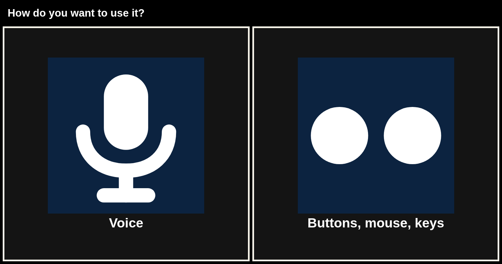
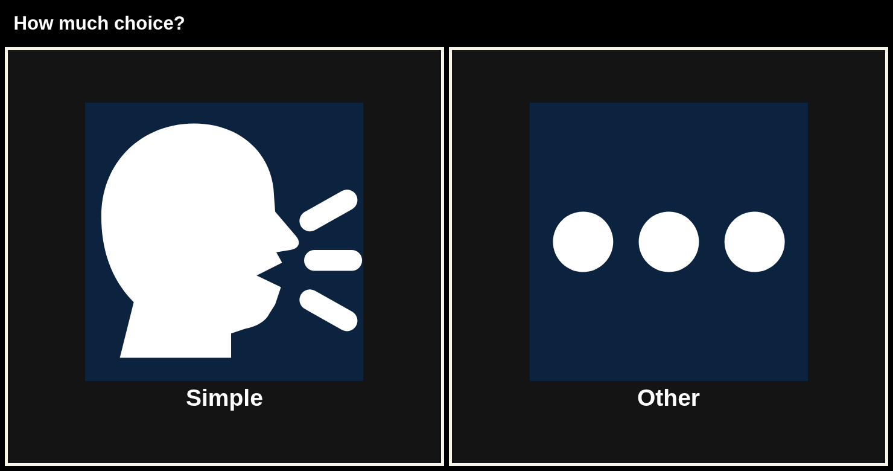
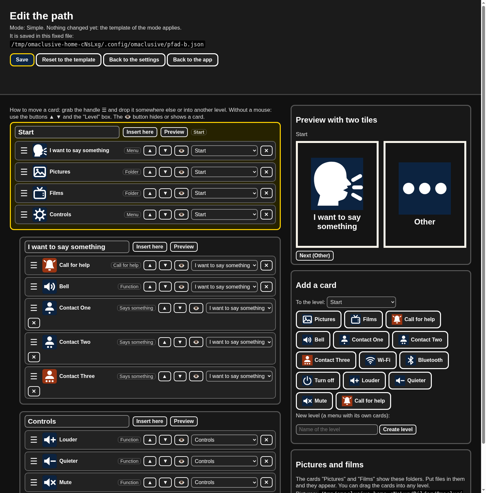
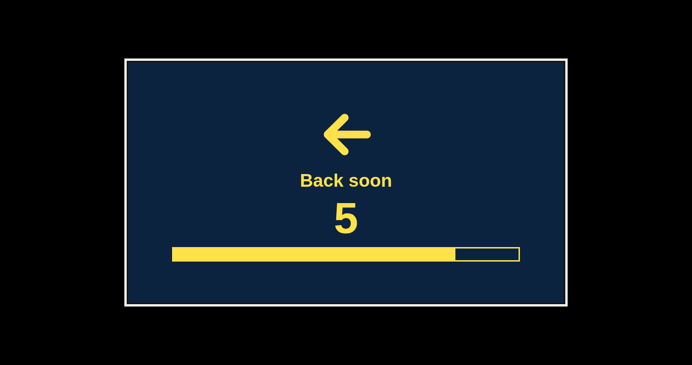

# Omaclusive

[Deutsch](README.de.md) · **English**

An open picture remote for Omarchy. Big picture cards, one or two buttons, everything offline on this computer.
No telemetry, no diagnosis and no therapy. The call for help is not a replacement for an emergency call.


## Not an emergency call (112)

**Omaclusive is not an emergency system.** The call for help only sends a message to a phone that you set up yourself.
Nobody is watching it, nothing is forwarded to rescue services, and the message can fail (no network, phone off, app closed).
In an emergency call **112** (EU) or your local emergency number, or let someone else call. Do not rely on Omaclusive for this.

## Disclaimer

- Omaclusive is **not a medical device**. It makes no diagnosis, gives no therapy and promises no result.
- You use it **at your own responsibility**. Caregivers decide whether it suits the person using it.
- The software is licensed under the GPL-3.0, **without any warranty** (see `LICENSE`, sections 15 and 16).
  The authors are not liable for damage that comes from using it.

## Privacy

- **No telemetry.** Omaclusive does not track you, has no accounts and sends no usage data.
- Everything runs on this computer, offline: pictures, movies, voice, speech recognition.
  The one exception is the **call for help**. It sends a short message to a ntfy server.
  The default is `https://ntfy.sh`, a public service run by a third party. You can enter your own ntfy server in the caregivers' area.
- What is sent: the fixed text "Someone wants to say something." to a long random topic. **No name** is sent.
  The name is only spoken on this computer. The server sees the topic, the time and the IP address of this computer, as with any web request.
- **Keep the topic secret.** Whoever knows the topic can read the messages and send messages to it.
  Share the link only with the phones that should receive the call, and do not post it online. A new random topic can be created in the caregivers' area.
- **TV** (and radio as a stream) only fetches the programme when someone picks a channel, straight from the address entered. The broadcaster sees the IP address of this computer. Omaclusive sends no data of its own.
- Without a network nothing is sent. The rest keeps working.

## On this computer

The server listens only on `127.0.0.1`. Each start creates a new session secret and stores it so that only this user can read it (`0600`, under `$XDG_RUNTIME_DIR/omaclusive/` when that directory is private, otherwise under `~/.local/share/omaclusive/run/`). The launcher passes it to this user's browser. There is no login and no extra step for the person who presses the two buttons.

Other accounts on the same computer cannot power off, reboot, open links, change the config, or run a tile action. Host and Origin checks apply to every protected route, including tile actions. Opening something, going back, the file chooser, and the hint sound use POST. A `confirm: true` field in the request does not turn the computer off: power-off, reboot, and lock run only after the server has issued a one-time confirmation for that question and the Yes tile sends it back.

## Installation

```bash
git clone https://github.com/smeekraft/omaclusive.git
cd omaclusive
./install.sh
```

Then open your app launcher and search for **Omaclusive**. It does not start by itself. The first start asks a few big questions.

`install.sh` needs no root. It makes its own copy under `~/.local/share/omaclusive` and downloads Piper and a voice, with a checksum.
Language: without options it follows your system language (`$LANG`: German or English, otherwise English). Force one with `./install.sh --lang en` or `--lang de`.
You can change the language and the voice later in the app: hold the small **⚙ Set up** key for 3 seconds, then pick **🌐 Language**. The voice is downloaded the first time you pick it (about 65 MB, checked with a checksum).
Requirements: Omarchy or something Arch-like, `chromium`, `python3`, `curl`, optionally `mpv` for movies and TV, `yt-dlp` for YouTube live channels.

## As an Omarchy plugin

Omaclusive can live in the Omarchy (Quattro) top bar as one calm icon.

```bash
omarchy plugin add https://github.com/smeekraft/omaclusive.git --enable
```

`omarchy plugin add` itself runs nothing. On the first click on the icon a terminal opens and runs this plugin's own `install.sh` (no root rights needed), so you see every step. After that a click starts Omaclusive full screen.

Requirements: `python3`, `chromium`, `curl`. Optional: `mpv`, `yt-dlp`, `espeak-ng`.
External downloads by `install.sh`: Piper (GitHub release) and one Piper voice, both checked with sha256.
`install.sh` does not touch an existing `config.json`.

Update: `omarchy plugin update smeekraft.omaclusive`, then run `./install.sh` once more in `~/.config/omarchy/plugins/smeekraft.omaclusive`.

Remove:

```bash
omarchy plugin remove smeekraft.omaclusive
rm -rf ~/.local/share/omaclusive ~/.local/share/applications/omaclusive*.desktop
```

## For relatives and caregivers

This is the short version for the person who sets Omaclusive up.

- **Files.** Put pictures in `Bilder/Omaclusive` and movies in `Videos/Omaclusive`, both in the home folder.
  They show up as cards. An empty folder shows one card that says there is nothing here yet.
- **Caregivers' area.** At the top right there is a small button **⚙ Set up**. **Hold it for 3 seconds** (mouse, or both arrow keys together) until the yellow bar is full.
  Here you can choose the mode, edit the path with drag and drop, change the contacts, open the picture sheet to laminate, set up the call for help, switch the picture set, and choose the speed. **Ctrl+Shift+E** works too.
- **The buttons.** Omaclusive only ever shows two big tiles. Any switch or button that sends a key will do, and so does a mouse.
  - Two buttons (default): the **left arrow** picks the left tile, the **right arrow** the right tile. With a mouse: **left click** is button 1 (left),
    **right click** is button 2 (right). Clicking a tile directly works too. A cheap two-button mouse replaces two buttons.
  - One button: the marker moves by itself from tile to tile. **Space, Enter or up arrow** (with a mouse: any click) picks the marked tile.
  - Presses that come too fast (under 300 ms) do not count and make the tile flash yellow for a moment.
- **Microphone.** The microphone ear (voice control) is off. `"hoeren": true` in `config.json` turns it on. With Bluetooth headphones it can make the sound worse.
- **Speed (one button).** `knopf.scanMs` is the time per card in milliseconds. Allowed: `400` to `10000`, the example config uses `3000`.
  **If the person often misses the card, make it slower** (for example `4000` or `5000`). The caregivers' area has a button for slow (3 s), normal (2 s) and fast (1 s).
- **Back to the start.** With no input Omaclusive goes back to the start after `zurueck.sekunden` seconds (default `20`, `0` is off, at most `60`).
  Five seconds before, a warning appears: big picture, a big number counting down and a bar that runs empty, and the voice says "Going back to the start in a moment." once. Any input cancels it. If the person needs more time, raise it. The caregivers' area offers 20, 30, 40 seconds or off (the mode sets a start value).
- **Voice speed.** `stimmeTempo` in `config.json` (default `1.15`, calmer than the Piper original). Higher is slower, for example `1.3`. Allowed `0.5` to `2.0`.
  The ready-made recordings in `audio/` are made with `1.15` (`python3 audio_erzeugen.py`); with another value the sentences are made live by Piper.
  The announcement only says the two picture words. A new announcement stops the old one. Playback errors go to `~/.local/share/omaclusive/log.txt`.
- **Test it with the person** before you rely on it, and stay nearby at first.

## Language: English and German

Omaclusive comes in English and German. This covers on-screen text, spoken announcements, the setup, the example cards and the voice.

- `config.json` has `"language": "en"` or `"language": "de"`. If it is missing, German is used.
  Any other language falls back to English. If a single text is missing, the German original is shown.
- In the app: **Set up, Language and voice**. Big tiles: Deutsch, English (US, male, default), English (US, female), English (US, female, best quality), English (UK, female). On the very first start the language is the first question (Deutsch | English, your system language preselected). The voice is downloaded the first time you pick it, with a checksum. All listed voices are public domain (see `CREDITS.md`).
- A new copy in English: `./install.sh --lang en`. This downloads the default English voice (John, male, public domain) and uses `config.example.en.json`.
- Switch an existing copy: `python3 sprache_wechseln.py en` (back: `de`). It only translates the texts that ship with Omaclusive.
  Your own names and sentences stay as they are. A backup `config.json.bak` is made. Restart the server afterwards.
- Texts live in `locales/de.json` and `locales/en.json`. The key is the German original text.
  To add a language, create `locales/<code>.json` and add an entry to `voices.json` (language, voice model, URL path and SHA256). The app then lists it by itself. `modi.json` needs screens for the new language, or the English templates are used.
- Plugins: `plugin.json` is German, `plugin.en.json` next to it is English. If the English file is missing, `plugin.json` is used.
- Recordings: `audio/de/` and `audio/en/` hold the fixed announcements as ready-made files, so they sound right away, even without Piper.
  Re-create them with `python3 audio_erzeugen.py`. Sentences with names are spoken live.
- Voice listening ("Say one"): German uses `ohr/model`, English uses `ohr/model-en` (Vosk small-en-us). If the English model is missing, voice listening stays off. Keys and pictures keep working.

## Card pictures: smooth or pixel

Two complete picture sets ship with Omaclusive. Same file names, same colours (Yes yellow, No and Back blue with a yellow symbol, the call for help and Pain red, contrast at least 7:1).

- **smooth** (default): clean lines, easy to recognise. `img/glatt/` and `plugins/<name>/glatt/`.
- **pixel**: the Omarchy-style pixel look. `img/pixel/` and `plugins/<name>/pixel/`.

Choose it in `config.json` with `"bildstil": "glatt"` or `"bildstil": "pixel"`. If it is missing, smooth is used. The setup page has a button **Pictures: smooth / Pictures: pixel** that switches and saves it.
Old configs with `img/xyz.svg` keep working: the server hands out that picture from the chosen set. `img/glatt/xyz.svg` or `img/pixel/xyz.svg` pins one set. A plugin may keep its pictures right in its folder; they are used when there is no `glatt/` or `pixel/` subfolder. Restart is not needed, reload the page.
The picture sheet (caregivers' area) always uses the pixel set.
Re-create the sets with `python3 tools/karten_glatt.py img/glatt plugins/grundbeduerfnisse/glatt` and `python3 tools/karten_pixel.py img/pixel plugins/grundbeduerfnisse/pixel`.

## Everyday use

In the default mode (b) there are seven areas at the start: **I want to say something**, **Pictures**, **Movies**, **TV** (only with channels set up), **Radio**, **Tasks**, **Controls** (volume, Wi-Fi, Bluetooth, turn off).
Bluetooth needs `bluetoothctl` (BlueZ). The rule everywhere: **at most two big tiles**, Back and Start are always reachable, calm and predictable.
Everything else is an add-on. A folder `plugins/<name>/` with `plugin.json` and pictures
becomes a card as soon as it is there. Remove it and the card is gone.
One example ships with it, Basic needs: Thirst, Hunger, Bathroom, Pain, Pause, Cold, Warm.
Every card says one sentence. Empty cards stay invisible.

Pictures live in `Bilder/Omaclusive`, movies in `Videos/Omaclusive`, both in the home folder.
Relatives put the files there. An empty folder shows one card and says: "There is nothing here yet."
There is no file dialog to get lost in.

**Pictures.** After the folder is chosen the slideshow starts by itself (simple mode). Each picture stays `bildSekunden` seconds (default `10`, allowed 3 to 120). Two tiles: **Back** (to the start) and **Pause**. While paused the tiles are **Continue** and **Back**.

**Movies.** The list shows **two movies at once**, as before (scanning works as before). A third, small option **Next page** sits in a slim row below (with a small **Back**). It can be reached by scanning, by mouse click, or with the arrow down key. After the last page it starts again from the first. A film plays inside the window with two tiles, **Back** and **Pause** (paused: **Continue** and **Back**). If the browser cannot play a format (for example some `.mkv` files), the film opens with `mpv` instead; there is no Pause tile then (mpv has its own keys). If mpv is missing, the card says "This does not work here." and goes home.

## Radio

Radio is a main tile. The source is in `config.json` under `radio`:

```json
"radio": { "modus": "browser", "name": "Radio", "url": "https://openradioworld.com/", "stream": "" }
```

- `modus: "browser"` opens `url` in its own full-screen browser window (fallback, always works with internet).
- `modus: "stream"` plays `stream` (an `http(s)` audio stream) **inside** Omaclusive with the tiles Back and Pause.
- No address set: the card honestly says "This is not set up yet." Nothing opens.

What is true about **Open Radio Atlas**: it is a native Omarchy plugin (Quickshell, a globe with mpv), not a web page. It cannot be embedded in the Omaclusive window and has no documented launch command, so Omaclusive does not start it. The default is therefore the browser page *Open Radio World*; a favourite station as a stream URL is the calm, reliable option. Both are edited in the caregivers' area (`setup.html`). Radio needs internet (or a station in the local network).

## TV

**TV** is a main tile (modes b and c). Behind it there is one tile per favourite channel, usually two or three. As everywhere, at most two tiles are shown; with more channels **Other** pages on.

- One press on a channel starts it **right away, full screen** (with `mpv`). No start animation, no control bar, no text, no menu.
- Full screen, two buttons: **left = back to the start**, **right = pause / continue**, **hold both for 3 seconds = back** (the time is `setupHoldMs`). **Esc** works too. With a mouse: left click = left, right click = right.
  One button (`knopf.modus` `"ein"`): short press = pause / continue, hold for 3 seconds = back. The lock time `debounceMs` applies as everywhere.
- **If a channel does not work** (no network, wrong address, no picture after `fernsehen.wartenSekunden`, default `30`): a calm picture with "Not working now", a short announcement, then the start. A press closes the message, otherwise it goes away after 8 seconds. No technical text.
- Without a channel set up the tile is invisible. Then everything is as before.
- A reminder ends the TV so that it can be seen.

The channels live in `config.json` (the caregivers' area has **Save channels** for up to three):

```json
"fernsehen": {
  "sender": [
    { "name": "DW", "bild": "img/fernsehen.svg", "stream": "https://dwamdstream102.akamaized.net/hls/live/2015525/dwstream102/index.m3u8" }
  ],
  "wartenSekunden": 30
}
```

- `stream`: an `http(s)` address that `mpv` can play (a broadcaster's HLS `.m3u8`) or a **YouTube live link** (`mpv` needs `yt-dlp` for that). At most 6 channels.
- `bild`: a picture from `img/` (default `img/fernsehen.svg`).
- The page only sends the number of the channel. The server always reads the address from `config.json`.
- TV needs internet. Some broadcasters only stream inside their country or black out single programmes for rights reasons. Addresses change sometimes; then enter the new link.
- No account, no telemetry. Omaclusive itself only opens the address you entered (through `mpv`).

**Calm and safe for photosensitivity (epilepsy).** Nothing in the TV part flashes, blinks, shakes or flickers, and there is no start animation (rule after WCAG 2.3.1: never more than three flashes per second, here none at all). `mpv` starts with `--osc=no --osd-level=0 --no-osd-bar`, without subtitles and without its own config, black until the picture arrives. The "Not working now" message is a still picture. Omaclusive has no influence on what the channels themselves show.

## Reminders and tasks

Caregivers maintain both in the caregivers' area, page **Reminders and tasks** (`pflege.html`). The data is stored in `~/.config/omaclusive/pflege.json`.

- **Reminder:** time, short text, repeat (once, daily, weekdays, weekend, chosen days). When it is due, the text is shown big and **read aloud** (repeated about every minute, up to ten times). One single tile, **Okay**, confirms it (any key does). A confirmed reminder does not come back that day. A running film or radio is paused meanwhile. The check runs every `erinnerungPruefSekunden` (default 20), repeats after `erinnerungWiederholSekunden` (default 60).
- **Task list:** the start tile **Tasks** shows one open task at a time; the tile checks it off and the next appears. At the end it says "Nothing to do."
- Limits: 30 reminders, 50 tasks, 120 characters each. The API is local only.
- Basic needs (thirst, hunger, pain ...) stay under "I want to say something". The call for help is unchanged.

## Streaming services (placeholder)

Netflix, Joyn and others are **not** part of this version. `config.json` only has `"streaming": {"aktiv": false, "dienste": []}` as a placeholder. It does nothing.

## Omarchy without a mouse

Everything works with the arrow keys or the left and right mouse button (also with one button and scanning). The arrow down key means "Next page" in lists.

Start path: `start-talker.sh` starts the server on `127.0.0.1:8795`, then opens Chrome/Chromium with `--kiosk --start-fullscreen --class=omaclusive` and its own profile. The browser receives the session secret from a private start file (see "On this computer"). `startlib.sh` checks for 20 seconds that the window really has focus (`hyprctl activewindow`) and calls `hyprctl dispatch focuswindow class:omaclusive` if not, so the keys arrive. Autostart: tick **Start at login** in the caregivers' area (see above). The mouse cursor is not needed. The page also takes the focus itself when it opens.
Optional Hyprland key to bring it back: `bind = SUPER, O, exec, hyprctl dispatch focuswindow class:omaclusive` in `~/.config/hypr/bindings.conf`.

Contacts under "I want to say something" are placeholders: Contact One, Two and Three.
The name is spoken. No real people are in here.

The caregivers' area has a **picture sheet**: the same pictures as on screen, ready to laminate.
The call for help stays the first card under "I want to say something", then the bell, then the contacts.

Autostart (a session startup file, no automatic login) is never set silently. In the caregivers' area it is a tick box **Start at login**: ticked creates `~/.config/autostart/omaclusive.desktop` (it runs `start-talker.sh` of this folder), unticked removes exactly that file. The box shows the real state (it reads whether the file exists), and `autostart` in `config.json` follows it. The setup only creates it after an explicit **Yes**.

**Choosing a tile.** The chosen tile grows smoothly to 1.15x with a thicker frame and stays like that for `waehlSekunden` seconds (default `3`, `0` = at once, at most `10`) before the action runs. Pressing the other key meanwhile cancels. This makes the result predictable.

SMS is not part of the core. It would be a separate add-on module later.

## First opening

If `einrichtung.fertig` in `config.json` is not `true` (a fresh config), or the setup is from an older version (no `einrichtung.stand`), Omaclusive starts with the setup as the very first thing.
It waits with no time limit and never skips by itself: nothing is chosen until someone presses a tile.
Every question shows at most two big tiles and is spoken aloud:

1. **How do you want to control it?** **Voice** or **Buttons, mouse, keys**. Voice turns the microphone ear on (`"hoeren": true`, needs Vosk, optional).
2. **How many buttons?** (only for buttons) **Two buttons** or **One button**.
3. **How many choices?** **Simple** (mode b, the default), and via **Other** **Very simple** (mode a) or **More choices** (mode c).
4. **Start with the computer?** **No** (left, the default) or **Yes**. Without an answer it is No.

The simple default (two buttons, arrows and mouse, mode b) only applies when it is chosen on purpose: pick **Buttons, mouse, keys**, **Two buttons**, **Simple**.
The setup only creates an autostart entry after an explicit **Yes** on the last question. **No** touches nothing. The caregivers' area has the tick box "Start at login" to change it later.
The example configs (`config.example*.json`) are never `fertig`. To see the setup again: `rm -f config.json && cp config.example.json config.json`.




## The three modes

A mode is a fixed path with fixed times. You choose it in the setup and later in the caregivers' area (button "Mode"). Templates live in `modi.json` (German and English).
At most two tiles are ever shown at the same time, in every mode.

| Mode | For | Path | Times |
|---|---|---|---|
| **a** Very simple | very severe physical and cognitive limitations | one level, at most 3 cards: call for help (asks "Really?" first), Pictures, Movies. No submenus. | one button recommended, 4.5 s per card, back to start after 45 s |
| **b** Simple (default) | seniors, people unfamiliar with technology | 4 areas (Say, Pictures, Movies, Controls), at most 2 levels, familiar words | 3 s, 20 s |
| **c** More choices | mild cognitive and/or psychological impairment | up to 3 levels, volume, Wi-Fi, Bluetooth, extra pack "Basic needs" | 3 s, 60 s |

Switching the mode in the caregivers' area sets these times and uses the path of that mode.

## The path editor (for relatives)



In the caregivers' area: **Edit the path (drag and drop)** (`editor.html`). Only reachable on this computer (127.0.0.1).

- The path appears as a tree of levels with their cards. Drag a card by the handle ☰ to another place or into another level.
  Without a mouse use ▲ ▼, the "Level" box on each card, or focus a card and press **Alt+Arrow up/down**.
- 👁 hides or shows a card, ✕ removes it. "Add a card" takes cards from the library (also the folder cards **Pictures** and **Movies**, which show `Bilder/Omaclusive` and `Videos/Omaclusive`). "Create level" makes a new menu.
- The preview shows what the person sees: two tiles.
- **Save** writes your own path to a fixed file: `~/.config/omaclusive/pfad-<mode>.json` (shown at the top of the editor and in the caregivers' area).
  **Reset to the template** deletes that file, then the template of the mode applies again. `pfadDatei` in `config.json` may name another plain file name (no folders) in the same folder.
- The server checks every save: known actions only, no cycles, at most 3 levels, pictures only from `img/`, no path tricks, at least one visible card at the start. Writing is only accepted from this computer.

## Screen

There are always exactly two big tiles and nothing else (no corner bar, no Help button). The top only shows the name of the level and, small, the setup key.
If a level has three or more cards, **Other** is on the right and pages on. If it has exactly two, both are shown.
In sub-levels **Back** joins the row as a normal tile. On the start, **I want to say something** is the first, big tile.
Yes and No only appear for a real question ("Really?"), and then exactly those two are the tiles. No is on the left, Yes on the right.

Start, at most three levels:

1. I want to say something: call for help, bell, then up to three contacts.
2. Pictures: photos from `Bilder/Omaclusive`.
3. Movies: movies from `Videos/Omaclusive`.
4. Controls: volume, Wi-Fi, Bluetooth, turn off.

Empty targets, empty links and missing files are not shown as cards.
An empty photo or film folder is a status card, not a dead link.

Turn off asks "Really?" first. No is on the left. Without Yes nothing happens.
Wi-Fi off also asks, as soon as the list offers it.

## Back to the start



With no input it returns to the start after `zurueck.sekunden` (mode b: **20 seconds**). Five seconds before, the screen shows a big picture,
a big number that counts down and a bar that runs empty. The voice says "Going back to the start in a moment." exactly once.
Any key, click or button press cancels it, counts as an input and starts the time again. If nothing happens, the number reaches 0 and it jumps to the start.
A slideshow is separate: a key there goes straight to the start.

In `config.json` under `zurueck`:

- `sekunden`: `0` or `"aus"` up to `60`. Default `20`. The timer does not run at the start itself.
- `hinweis`: `"ansage"` or `"ton"`.
- `hinweisVorherSekunden`: default `5`.

## Operation

The marked tile (one-button scan only) has a thicker border and is announced. The shape carries the meaning too: **colour alone never carries the meaning.** Every tile also has a picture and a word.

One mapping applies everywhere, in the setup and in the app:

| Input | Two buttons (default) | One button (`knopf.modus` `"ein"`) |
|---|---|---|
| Left arrow, left click | left tile | picks the marked tile |
| Right arrow, right click | right tile | picks the marked tile |
| Space, Enter, up arrow | do nothing | picks the marked tile |
| Click directly on a tile | picks that tile | picks that tile |

- `Esc` goes to the start. The mouse context menu is off.
- One button: the marker moves every `knopf.scanMs` milliseconds (`400` to `10000`, example `3000`) and says the word. Slower is easier, see "For relatives and caregivers".
- `debounceMs` is the lock time against double presses (default `300`).
- `keys` in `config.json` changes the keys: `links`, `rechts`, `waehlen`.

Announcements use Piper, offline: German with the voice Thorsten, English with the male voice John by default (other voices can be picked in the app). Espeak-ng is the fallback.
The small key **⚙ Set up** at the top right opens the caregivers' area when held for 3 seconds (**Ctrl+Shift+E** works too).
`start-talker.sh` ends old Omaclusive servers and windows on the port before it starts, and brings the window into focus.

## Call for help

Call for help is the first card under "I want to say something". Two steps, with no extra Yes or No.

The call goes through ntfy (default server `https://ntfy.sh`, see "Privacy") to a long random channel. Keep that channel secret. On the phone there is a **Seen** button.
Omaclusive then says the name and shows the picture. Without a name it says "Someone".
The name is not in the text that arrives on the phone. That text is "Someone wants to say something."
Without a network, picture and voice stay: "The call was not sent."

A test goes out every 30 days, adjustable, or off. The first day after the channels are created
does not trigger a test. "Test now" does not wait for the calendar.
The caregivers' area says: the call for help sends your call to a phone and does not replace an emergency call.

The channels in `config.json` stay empty until the server has started once. Then they are created.

## Look

Every program tile is built from rectangles with a thick border. The marker is the same border, only thicker.
Yes is a dark tick on yellow, No a yellow cross on dark blue, the call for help a bell on orange,
Back a yellow arrow on dark blue. Motif and tile have a contrast of at least 7:1.
Your own photos stay photos and are not broken into pixels. No animation, no flashing.

## Start and installation

`start-talker.sh` and `start-talker-fenster.sh` use port **8795**. `install.sh` downloads Piper and the voice (Thorsten for German, John for English)
from the named releases, checks the checksum and aborts if it does not match.
It does not copy programs from outside the folder. It changes no keys and calls no root.
The target is its own copy, menu name Omaclusive.

## Checks

```bash
node test_pfad.js
node --check app.js
python3 test_ton.py
python3 test_farbe.py
python3 test_sprache.py
python3 test_hilferuf.py
python3 test_praxis.py
python3 test_i18n.py
python3 test_stimmen.py                           # language and voice choice
python3 test_bildstil.py
python3 test_tempo.py
python3 test_ansage.py
python3 test_audio.py
node test_i18n.js
python3 test_modi.py                               # modes, path store, editor API
python3 test_sitzung.py                            # session secret, origin checks, no GET actions
node --experimental-websocket test_editor.js    # browser test of the editor
python3 test_pflege.py                            # reminders and tasks
python3 test_fernsehen.py                         # TV: channels, calm mpv call, buttons inside mpv
node --experimental-websocket test_eingabe.js   # browser test with keyboard and mouse (needs ffmpeg for the film tests)
```

`test_bild.js` checks the page in a headless browser. It needs the local server running on a free port
(`PORT=8799 python3 server.py`) and a `config.json`. The page self-test runs in German.
Run it as `PORT=8799 node --experimental-websocket test_bild.js`. `test_eingabe.js` starts the server and Chrome itself, presses arrow keys and clicks with the left and
right mouse button (setup and app, one and two buttons, German and English). It briefly creates a `config.json` and deletes it afterwards.

## License and conduct

GPL-3.0, see `LICENSE`. Credits in `CREDITS.md`. How to help: `CONTRIBUTING.md`. Behaviour in the project: `CODE_OF_CONDUCT.md`.
